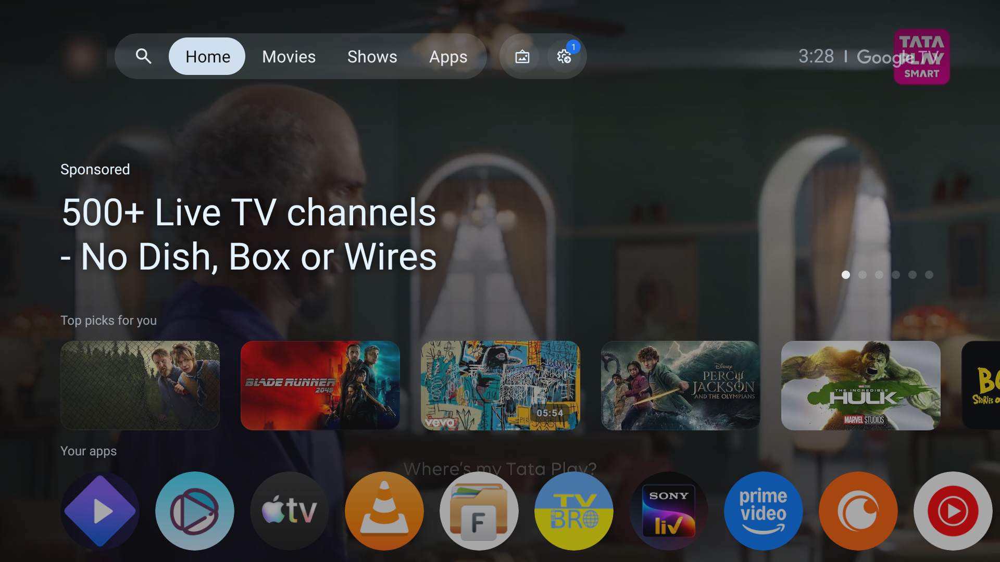
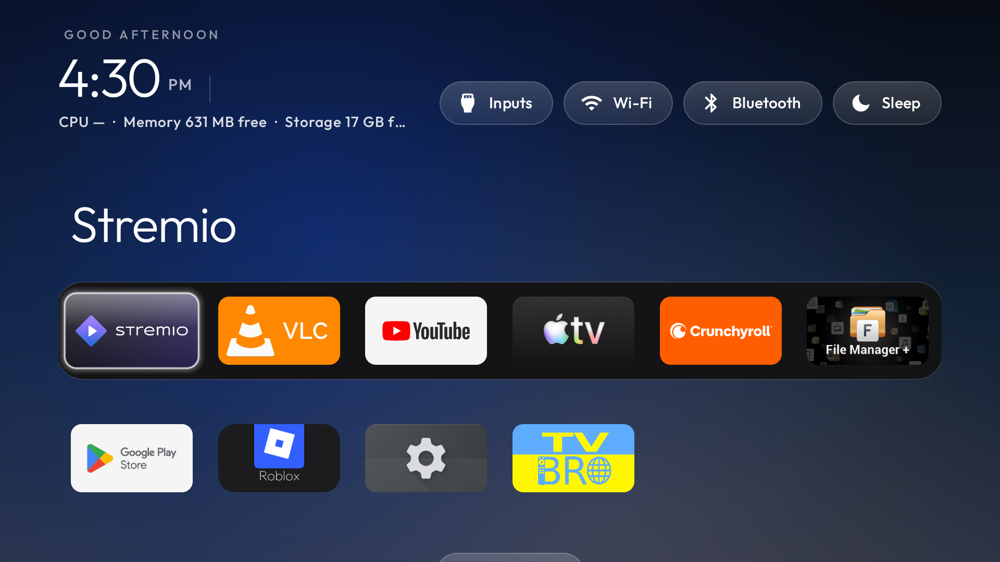

# CleanYourTV on the XGIMI Vibe One

A clean build for the XGIMI Vibe One projector (model WM03H, Google TV, Android 11), on top of
[CleanYourTV](https://github.com/Gathin23/cleanyourtv). Everything here runs over Wi-Fi, with no root and no cable,
and every change can be undone.

| Before | After |
|---|---|
|  |  |

## What's in this branch

- **Debloat lists** in [`debloat/`](debloat/): 16 packages in six batches, each with an apply and an undo line.
  They are disabled, never uninstalled: the store demo, two factory menus, a bug-report uploader, Google feedback,
  the Play auto-install config, the setup wizard (it grabs Home once the stock launcher is off), and apps I don't use.
- **The theme** I run, [`theme/config.json`](theme/config.json). Swap `com.example.player` for your own app.
- **Seven launcher features**, all off by default, so nothing changes for other TVs:

| Theme key | What it does |
|---|---|
| `key_shortcuts` | Remote buttons open the apps you choose. On the Vibe One, YouTube is `KEYCODE_F4`, Netflix `KEYCODE_F9` and Prime `KEYCODE_F8` |
| `settings_key_scancodes` | The remote's gear button opens TV Settings. On the Vibe One it is scancode `66` |
| `show_bluetooth_pill` | A Bluetooth pill: a press restarts Bluetooth so paired speakers reconnect, hold OK to pair something new |
| `show_sleep_pill` | A sleep timer: 15, 30, 60 or 90 minutes, then the projector goes to sleep |
| `show_settings_pill` | `false` hides the Settings pill to make room (the gear button still opens Settings) |
| `app_overrides` | Rename a tile and borrow another app's banner, e.g. show a YouTube client as "YouTube" with YouTube's artwork |
| `stock_home_redirect` | Sends Google's launcher straight back to this one when the firmware turns it on again |

## Why the Vibe One needs the last one

XGIMI's firmware keeps bringing Google's launcher back. Its key service (`com.xgimi.xrmservice`) switches the stock
launcher on again whenever you press the remote's YouTube, Netflix or Prime button, and it also comes back after a
power cycle with no key press at all. `pm disable-user` and `pm uninstall -k --user 0` both revert on reboot, because
the stock launcher is an updated system app.

So the build stops trying to keep it off. `HomeKeyService` watches for Google's home screen and returns to this
launcher. After a power-on you see Google's launcher for about a second, then this one. The idea comes from
upstream pull request [#479](https://github.com/Gathin23/cleanyourtv/pull/479).

The remote buttons are caught by the same accessibility service, before XGIMI's key service sees them. Test them
with the real remote: key events injected with `input keyevent` skip that filter, so they pass when the real
button would fail.

## Install

Follow the main [README](../README.md) to connect over Wi-Fi, then:

```bash
for f in xgimi-vibe-one/debloat/batch*.txt; do TV_HOST=<ip> tools/disable.sh "$f"; done
TV_HOST=<ip> HOME_KEY_SERVICE=1 launcher/build-and-install.sh
TV_HOST=<ip> tools/theme.sh xgimi-vibe-one/theme
```

`HOME_KEY_SERVICE=1` matters: the remote buttons, gear key, sleep timer and redirect all run in that service. It
needs JDK 17. If the service shows under "Crashed services" in `dumpsys accessibility` after a theme push, clear
`enabled_accessibility_services`, wait a second, and set it back.

## Tested on

XGIMI Vibe One (WM03H), Android 11, firmware RTMA.250416.186.13970001: every remote remap, the gear key, the
Bluetooth pill, the sleep timer and the redirect after a full power cycle. Not tested on other XGIMI models or on
Android 12 and newer, where Android stops apps from toggling Bluetooth.

## Undo

Each batch file's last comment line has its undo command. To bring the stock launcher back:
`TV_HOST=<ip> tools/restore.sh <batch-file> com.google.android.apps.tv.launcherx`.
